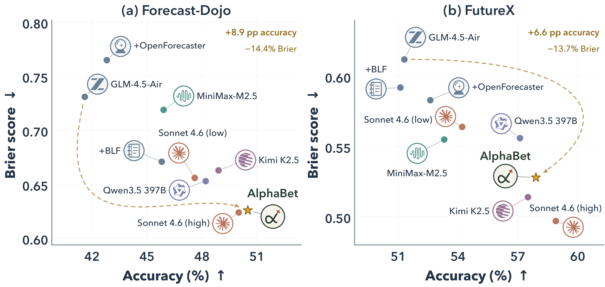
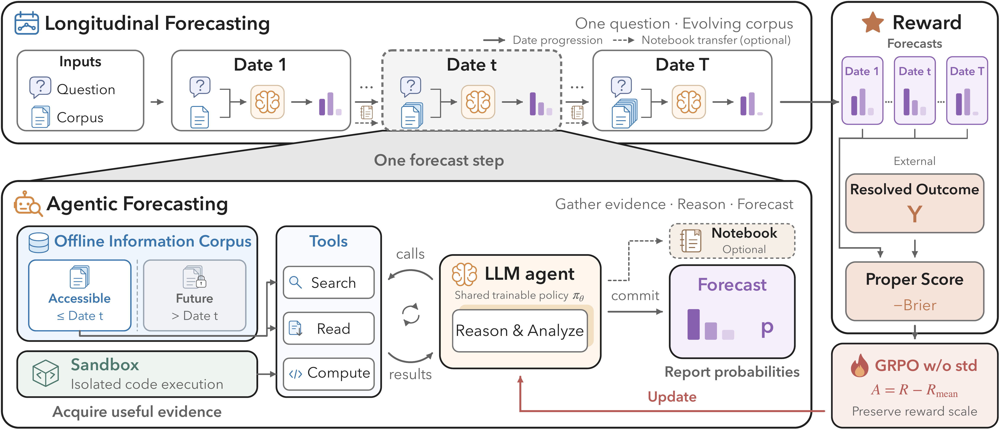

<h1 align="center">
  <sub><picture><source media="(prefers-color-scheme: dark)" srcset="assets/logo-dark.png"></picture></sub> AlphaBet: Reinforcement Learning for<br>
  LLM Event Forecasting Agents
</h1>

<p align="center">
  <a href="https://arxiv.org/abs/2610.22684"></a>
  <a href="https://alphabet-agent.github.io/"></a>
  <a href="https://huggingface.co/collections/liqinye/alphabet"></a>
  <a href="LICENSE"></a>
</p>

<p align="center">
  Liqin Ye<sup>1†</sup> · Rongzhi Zhang<sup>2</sup> · Xin Liu<sup>2</sup> · Zheng Li<sup>2</sup> · Yuan He<sup>2</sup> · Qingyu Yin<sup>2</sup> · Priyanka Nigam<sup>2</sup> · Chao Zhang<sup>1</sup><br>
  <small><sup>1</sup>Georgia Institute of Technology &nbsp;·&nbsp; <sup>2</sup>Amazon &nbsp;·&nbsp; <sup>†</sup>Work done during an internship at Amazon</small>
</p>

<p align="center"></p>

AlphaBet trains one LLM policy to search, reason and report probabilities for an event at several dates before it resolves. Each dated forecast is scored against the eventual outcome, so one resolved event supervises many information states.

<div align="center">
<table>
  <thead>
    <tr><th colspan="2">Forecast-Dojo</th><th colspan="2">FutureX</th></tr>
  </thead>
  <tbody>
    <tr>
      <td align="center">Brier&nbsp; 0.731 → <b>0.626</b></td>
      <td align="center">Accuracy&nbsp; 41.6 → <b>50.5%</b></td>
      <td align="center">Brier&nbsp; 0.612 → <b>0.528</b></td>
      <td align="center">Accuracy&nbsp; 51.3 → <b>57.9%</b></td>
    </tr>
  </tbody>
</table>
</div>

- **Framework** — outcome-based agentic RL over a temporally indexed news corpus; the agent reads only what was published by each forecast date.
- **Theory** — forecasting regret splits into an evidence-acquisition gap and a reporting gap; GRPO's std normalization distorts the proper-score target, mean-centering keeps it.
- **Results** — gains on both benchmarks come from better evidence *and* better probabilities; removing std normalization preserves proper scores at the same accuracy.

**Updates** · `[2026/10]` Paper on [arXiv](https://arxiv.org/abs/2610.22684) · checkpoints and dataset on [Hugging Face](https://huggingface.co/collections/liqinye/alphabet) · [project website](https://alphabet-agent.github.io/)

## Results

Forecast-Dojo test set (230 events, 797 question-dates) and FutureX (343 questions), March–May 2026; same agent loop and tool budget for every model. Bold: best within the GLM-4.5-Air block.

<div align="center">
<table>
  <thead>
    <tr>
      <th rowspan="2" align="left">Model</th>
      <th colspan="3">Forecast-Dojo</th>
      <th colspan="2">FutureX</th>
    </tr>
    <tr>
      <th>Acc % ↑</th><th>Brier ↓</th><th>−Info-α ↓</th>
      <th>Acc % ↑</th><th>Brier ↓</th>
    </tr>
  </thead>
  <tbody>
    <tr><td align="left">Uniform reference</td><td align="center">22.9</td><td align="center">0.771</td><td align="center">0.727</td><td align="center">30.6</td><td align="center">0.680</td></tr>
    <tr><td colspan="6" align="left"><i>Off-the-shelf references</i></td></tr>
    <tr><td align="left">Claude Sonnet 4.6 (high)</td><td align="center">50.0</td><td align="center">0.624</td><td align="center">0.364</td><td align="center">58.9</td><td align="center">0.497</td></tr>
    <tr><td align="left">Kimi K2.5</td><td align="center">48.9</td><td align="center">0.663</td><td align="center">0.530</td><td align="center">57.5</td><td align="center">0.514</td></tr>
    <tr><td align="left">Qwen3.5-397B-A17B (think)</td><td align="center">48.2</td><td align="center">0.653</td><td align="center">0.482</td><td align="center">57.1</td><td align="center">0.556</td></tr>
    <tr><td align="left">Claude Sonnet 4.6 (low)</td><td align="center">47.6</td><td align="center">0.656</td><td align="center">0.468</td><td align="center">54.2</td><td align="center">0.564</td></tr>
    <tr><td align="left">MiniMax-M2.5</td><td align="center">45.9</td><td align="center">0.719</td><td align="center">0.738</td><td align="center">53.3</td><td align="center">0.555</td></tr>
    <tr><td colspan="6" align="left"><i>GLM-4.5-Air</i></td></tr>
    <tr><td align="left">GLM-4.5-Air (base)</td><td align="center">41.6</td><td align="center">0.731</td><td align="center">0.726</td><td align="center">51.3</td><td align="center">0.612</td></tr>
    <tr><td align="left">&nbsp;&nbsp;+ BLF</td><td align="center">45.8</td><td align="center">0.671</td><td align="center">0.458</td><td align="center">51.1</td><td align="center">0.592</td></tr>
    <tr><td align="left">&nbsp;&nbsp;+ OpenForecaster</td><td align="center">42.8</td><td align="center">0.765</td><td align="center">0.845</td><td align="center">52.6</td><td align="center">0.583</td></tr>
    <tr><td align="left">&nbsp;&nbsp;+ AlphaBet single-date</td><td align="center">47.2</td><td align="center">0.668</td><td align="center">0.507</td><td align="center">53.2</td><td align="center">0.540</td></tr>
    <tr><td align="left">&nbsp;&nbsp;+ AlphaBet memory-on</td><td align="center">49.3</td><td align="center">0.630</td><td align="center">0.413</td><td align="center">55.2</td><td align="center">0.545</td></tr>
    <tr><td align="left"><b>&nbsp;&nbsp;+ AlphaBet memory-free</b></td><td align="center"><b>50.5</b></td><td align="center"><b>0.626</b></td><td align="center"><b>0.399</b></td><td align="center"><b>57.9</b></td><td align="center"><b>0.528</b></td></tr>
  </tbody>
</table>
</div>

## One question, many dates, one outcome

One policy revisits each training event at several pre-resolution dates, sees only what the world knew then, and is scored against the one eventual outcome: 1,028 training events become 3,965 question-date training states, with no extra labels.

<p align="center"></p>

- **Replayable corpus** — temporally indexed CC-News (March 2025 – May 2026, 18.8M articles; Qwen3-Embedding-8B + FAISS); only articles dated on or before the forecast date are retrievable.
- **Three tools** — `search`, `scrape` (read an article) and `python` (sandboxed compute), within 80 tool rounds and 200 calls per forecast date.
- **Proper-score reward** — negative multiclass Brier of each dated forecast against the outcome, plus format penalties.
- **GRPO without std** — rollouts are grouped per (question, forecast date); the advantage is A = R − R<sub>mean</sub>, with no division by the group's standard deviation.

| Variant | Mode | Carried across dates |
|:--|:--|:--|
| Memory-free | `memory-free` | Nothing; every dated forecast starts afresh. The paper's strongest variant. |
| Memory-on | `memory-on` | A belief notebook (probabilities, evidence, open questions). |
| Single-date | `single_date` (train) · `single-date` (data) | One fixed forecast date per event; the ablation. |

## The gains come from both acquisition and reporting

Freeze the evidence each policy retrieved on the Forecast-Dojo test set and let tool-free readers forecast from it. Every reader does better on AlphaBet's evidence, and with the same evidence AlphaBet reports better than its base model.

<div align="center">

| Reader (no tools), Brier ↓ | GLM-4.5-Air evidence | AlphaBet evidence | Question only | Δ acquisition ↑ |
|:--|--:|--:|--:|--:|
| GPT-5.6 Terra (xhigh) | 0.623 | 0.612 | 0.725 | +0.011 |
| Claude Sonnet 4.6 (high) | 0.649 | 0.638 | 0.763 | +0.012 |
| GLM-4.5-Air | 0.702 | 0.686 | 0.801 | +0.016 |
| AlphaBet memory-free | 0.642 | 0.628 | 0.765 | +0.014 |
| **Δ reporting ↑** (GLM-4.5-Air → AlphaBet) | +0.060 | +0.058 | +0.035 | |

</div>

## Mean-centering is enough; std normalization distorts the proper-score target

The same training with and without GRPO's standard-deviation step, under a Brier reward and a log-score reward. With it, both proper scores degrade while accuracy stays comparable.

<p align="center"></p>

<div align="center">

| Reward | Advantage | Brier ↓ | Log prob ↑ | Accuracy ↑ | Reliability ↓ |
|:--|:--|--:|--:|--:|--:|
| — | step 0 | 0.731 | −1.758 | 0.416 | |
| Brier | mean, then std | 0.715 | −1.812 | 0.473 | 0.054 |
| Brier | **mean only** | **0.668** | **−1.497** | 0.457 | **0.004** |
| Log | mean, then std | 0.774 | −2.106 | 0.469 | 0.095 |
| Log | **mean only** | **0.681** | **−1.519** | 0.451 | **0.007** |

</div>

## Models and data

| Artifact | What it is | Download |
|:--|:--|:--|
| **AlphaBet memory-free** | GLM-4.5-Air trained in memory-free mode; the paper's strongest variant | [liqinye/AlphaBet_memory-free](https://huggingface.co/liqinye/AlphaBet_memory-free) |
| **AlphaBet memory-on** | GLM-4.5-Air trained in memory-on mode, with the belief notebook | [liqinye/AlphaBet_memory-on](https://huggingface.co/liqinye/AlphaBet_memory-on) |
| **Forecast-Dojo** | Resolved Polymarket events with forecast dates, outcomes and market probabilities (CC-BY-4.0) | [liqinye/Forecast-Dojo](https://huggingface.co/datasets/liqinye/Forecast-Dojo) |

Checkpoints are `glm4_moe` safetensors (40 shards, ~214 GB each; 106B total / 12B active parameters). The dataset's `eval` split (230 events / 797 question-dates) is the paper's test set; its `train` split (1,338 events / 5,325 tasks) is larger than the paper's 1,028-event training set and reaches back to June 2025 — filter on `metadata.forecast_dates` to match the paper's window.

> [!NOTE]
> The news corpus and FAISS indexes are not hosted; build them with the [Forecast-Dojo](https://github.com/Forecast-Dojo/Forecast-Dojo) pipeline (layout under [Prepare data](#prepare-data)).

## Installation

Python ≥ 3.10. The root package pins `strands-env==0.1.0+alphabet`, which resolves only from the local `strands-env/` directory, so install it first:

```bash
git clone https://github.com/AlphaBet-Agent/AlphaBet.git
cd AlphaBet
pip install -e strands-env && pip install -e .
```

Model serving is separate: SGLang for the policy (`scripts/serve_model.sh`), vLLM for the embedding model (`scripts/serve_embeddings.sh`, in its own environment).

## Evaluate a released checkpoint

```text
download checkpoint + events → serve embeddings → serve policy → evaluate → read the scorecard
```

You also need a date-sharded FAISS index of the news corpus (not included), the Qwen3-Embedding-8B weights, GPUs for the 106B-A12B policy, and a Linux host with unprivileged user namespaces (the `python` tool fails closed without its sandbox). The examples use `/datasets`, `/models` and `/indexes`.

**1. Download** (`hf` is the Hugging Face CLI, `huggingface_hub` ≥ 0.34)

```bash
hf download liqinye/AlphaBet_memory-free --local-dir /models/AlphaBet_memory-free   # ~214 GB
hf download liqinye/Forecast-Dojo data/eval.jsonl --repo-type dataset \
  --local-dir /datasets/forecast-dojo   # lands at /datasets/forecast-dojo/data/eval.jsonl
```

**2. Serve the embedding model** (port 8001, served name `Qwen3-Embedding-8B`)

```bash
HOST=0.0.0.0 EMBEDDING_MODEL_PATH=/models/Qwen3-Embedding-8B \
  bash scripts/serve_embeddings.sh --tensor-parallel-size 1 --max-model-len 4096
```

**3. Serve the policy** (port 30000, tensor parallelism 4; extra arguments pass through to `sglang.launch_server`)

```bash
HOST=0.0.0.0 MODEL_PATH=/models/AlphaBet_memory-free bash scripts/serve_model.sh
```

**4. Evaluate.** Set `model.base_url`, `env.index_root`, `env.embedding_endpoint`, `data.questions_path` and `output_path` in the YAML (`model.tokenizer_path` is resolved through the Hub; point it at the checkpoint directory on an offline host), then:

```bash
bash scripts/evaluate.sh --config configs/eval/memory-free.yaml   # AlphaBet_memory-free
bash scripts/evaluate.sh --config configs/eval/memory-on.yaml     # AlphaBet_memory-on
```

Evaluate each checkpoint in its own mode. The release rows are memory-on episodes and run as they are with `memory-on.yaml`; `memory-free.yaml` needs one row per question-date, which is the per-date split of those episodes (exactly the paper's 797 question-dates):

```python
import json

DROP = ("forecast_dates", "crowd_probs", "crowd_distributions")
rows = [json.loads(l) for l in open("/datasets/forecast-dojo/data/eval.jsonl") if l.strip()]
with open("/datasets/forecast-dojo/data/eval_memory-free.jsonl", "w") as f:
    for r in rows:
        m = r["metadata"]
        keep = {k: v for k, v in m.items() if k not in DROP}
        for d, cp in zip(m["forecast_dates"], m["crowd_probs"]):
            row = {**r, "metadata": {**keep, "forecast_date": d, "crowd_prob": cp}}
            f.write(json.dumps(row) + "\n")
```

**5. Read the results.** A scorecard (Brier, log loss, accuracy, Info-α) prints at the end; `output_path` holds one JSON record per forecast step plus a `.manifest.json` with the resolved config. Re-running the same `output_path` resumes. To re-score a file:

```python
from evaluation.metrics import format_scorecard, score_run

print(format_scorecard(score_run("outputs/memory-free.jsonl")))
```

<details>
<summary>Command-line flags</summary>
<br>

With `--config`, only `--output-path`, `--concurrency` and `--n-rollouts` override the file. Without it, `--model`, `--index-root`, `--questions-path` and `--output-path` are required.

- `--config PATH` — YAML or JSON `RunConfig`
- `--model NAME` — preset (`glm-4.5-air`, `qwen3-30b`, `claude-opus`) or an ad-hoc label; `--model-id ID` overrides its path
- `--backend {sglang,bedrock,kimi}` — model backend (default `sglang`)
- `--index-root PATH`, `--questions-path PATH`, `--output-path PATH`
- `--mode {memory-on,memory-free}` — must match the row format (default `memory-on`)
- `--split LABEL` — label stamped into every record
- `--no-search` — tool-free environment; not yet wired into the harness (`NotImplementedError`)
- `--concurrency N` (default 8), `--n-rollouts N` (default 1)

</details>

## Prepare data

`scripts/prepare_data.sh` builds the mode-specific JSONL from the raw Forecast-Dojo question files (`filtered_info.jsonl` from the [Forecast-Dojo](https://github.com/Forecast-Dojo/Forecast-Dojo) pipeline); `--help` after a mode lists all options.

```bash
bash scripts/prepare_data.sh memory-free --input QUESTIONS --output DATASET --auto-k
bash scripts/prepare_data.sh memory-on   --input QUESTIONS --output DATASET --auto-k
bash scripts/prepare_data.sh single-date --input MEMORY_FREE_DATASET \
  --out DATASET --seed 20260918
```

| Mode | One row per | Date fields in `metadata` | Consumed by |
|:--|:--|:--|:--|
| `memory-free` | question × forecast date | `forecast_date`, `crowd_prob` | `configs/train/memory-free.sh`, `configs/eval/memory-free.yaml` |
| `memory-on` | event, with its forecast dates | `forecast_dates`, `crowd_probs` | `configs/train/memory-on.sh`, `configs/eval/memory-on.yaml` |
| `single-date` | event, one seeded date | as memory-free | `configs/train/single_date.sh` |

`--auto-k` picks 3–10 forecast dates per question, each at least 2 days before resolution. Seed 20260918 reproduces the paper's single-date subset from the paper's memory-free training file.

| Split | Events | Question-dates | Window |
|:--|--:|--:|:--|
| Train | 1,028 | 3,965 | forecast dates 2025-08-01 → 2026-02-28 |
| Validation | 80 | 344 | events closing 2026-01-01 → 2026-02-28 |
| Test | 230 | 797 | events resolving March–May 2026 |
| FutureX | 343 | — | L1–L2 questions |

The retriever expects dated shards (`YYYY-MM` or `YYYY-MM-DD`) under the index root:

```text
/indexes/faiss_index_monthly/
├── 2025-03/
│   ├── faiss.index
│   ├── texts.parquet
│   └── metadata.json      # monthly shards also carry day_offsets
├── 2025-04/
└── ...
```

## Train

> [!IMPORTANT]
> The paper's runs use 128 H200 GPUs (16 nodes × 8) plus 8 for retrieval; a 120-step memory-free run takes about 62 hours. `configs/train/common.sh` encodes this topology; override its variables for other hardware.

Training runs on [slime](https://github.com/THUDM/slime) with [Megatron-LM](https://github.com/NVIDIA/Megatron-LM), SGLang and Ray, none of which is vendored: `scripts/train.sh` submits a job to a running Ray cluster that has this stack installed. Keep the embedding service running.

```bash
SLIME_ROOT=/root/slime \
MEGATRON_ROOT=/root/Megatron-LM \
TRAIN_PYTHON=python \
MODEL_PATH=/models/GLM-4.5-Air \
REF_LOAD=/models/megatron_checkpoint \
TRAIN_DATA=/datasets/memory-free/forecast_train.jsonl \
EVAL_DATA=/datasets/memory-free/forecast_validation.jsonl \
INDEX_ROOT=/indexes/faiss_index_monthly \
EMBEDDING_ENDPOINT=http://embedding-host:8001/v1 \
bash scripts/train.sh memory-free

# bash scripts/train.sh memory-on | single_date      other modes, with matching inputs
# bash scripts/train.sh memory-free --dry-run        print the resolved command only
# FORECAST_GRPO_STD_NORM=1 ...                        GRPO with std normalization (ablation)
# FORECAST_REWARD_METRIC=log_prob ...                 log-score reward instead of Brier
```

| Variable | Required | Meaning |
|:--|:-:|:--|
| `SLIME_ROOT` | yes | slime checkout containing `train.py` |
| `MODEL_PATH` | yes | Hugging Face checkpoint of the policy (GLM-4.5-Air) |
| `REF_LOAD` | yes | Megatron-format checkpoint of the base model (`--ref-load`) |
| `TRAIN_DATA` | yes | prepared training JSONL for the chosen mode |
| `INDEX_ROOT` | yes | FAISS index root |
| `EMBEDDING_ENDPOINT` | yes | embedding service URL |
| `EVAL_DATA` | | validation JSONL; evaluation every 4 steps |
| `MEGATRON_ROOT`, `TRAIN_PYTHON`, `MODEL_ARGS_SH` | | Megatron-LM checkout; interpreter (default `python3`); model arguments (default `$SLIME_ROOT/scripts/models/glm4.5-106B-A12B.sh`) |
| `RAY_DASHBOARD_ADDRESS`, `RUN_DIR` | | Ray job address (default `http://127.0.0.1:8265`); run directory (default `outputs/<mode>`, checkpoints in `$RUN_DIR/checkpoints`) |
| `WANDB_PROJECT`, `WANDB_GROUP` | | Weights & Biases logging |

<details>
<summary>Hyperparameters (<code>configs/train/common.sh</code>, paper Table 3)</summary>
<br>

| Setting | Value |
|:--|:--|
| Rollouts per group | 16 at temperature 1.0 |
| Prompt / response length | 8,192 / 16,384 tokens |
| Groups per rollout step | 128 (memory-free, single_date) · 64 (memory-on) |
| Optimizer batch | 1,024 (memory-free, single_date) · 512 (memory-on) rollouts |
| Optimizer | Adam, lr 1e-6 constant, β = (0.9, 0.95), weight decay 0.1 |
| Clipping / regularizers | ε = 0.20 / ε<sub>high</sub> = 0.28; no entropy or KL term |
| Precision | bf16 |
| Parallelism | TP 4 · PP 1 · CP 2 · EP 8 · ETP 4; 8 GPUs per SGLang engine, DP-attention 8 |
| Reward | −Brier plus format penalties (answer 1.0, tool 0.5) |
| Compute tool | 10 s timeout, 4,096 MB per call |
| Checkpoints and evaluation | every 4 steps |
| Rollout steps | `NUM_ROLLOUT`, default 1000 (the paper's figures are 120-step runs) |

| Variable | Default | Effect |
|:--|:--|:--|
| `FORECAST_REWARD_METRIC` | `brier` | score optimized by GRPO: `brier` or `log_prob` |
| `FORECAST_GRPO_STD_NORM` | `0` | `1` divides centered rewards by the group std |
| `FORECAST_ENABLE_CODE` | `1` | `0` removes the Python tool |
| `FORECAST_FORMAT_COEF`, `FORECAST_TOOL_FORMAT_COEF` | `1.0`, `0.5` | format penalty weights |
| `FORECAST_CODE_TIMEOUT`, `FORECAST_CODE_MEMORY_MB` | `10`, `4096` | Python sandbox limits per call |
| `FORECAST_SEARCH_BACKEND` | `cpu` | `gpu` routes search to `FORECAST_SEARCH_ENDPOINT` (not included) |
| `FORECAST_MAX_STEPS` | `100` | GRPO group-index stride; at least the longest episode's number of dates |

</details>

## Repository layout

```text
configs/
  eval/                 memory-free.yaml, memory-on.yaml
  train/                common.sh (defaults), memory-free.sh, memory-on.sh, single_date.sh
scripts/
  prepare_data.sh       build memory-free, memory-on or single-date task files
  train.sh              submit a slime GRPO run to a Ray cluster
  evaluate.sh           run the benchmark harness (python -m evaluation)
  serve_model.sh        SGLang policy server
  serve_embeddings.sh   vLLM server for Qwen3-Embedding-8B
prompts/                system prompts: {memory-free, memory-on} x {tools, no code, no tools}
src/
  data/                 forecast-date selection and dataset builders
  environment/          ForecastEnv loop, search/scrape/python tools, notebook parsing, rewards
  training/             slime rollout callbacks and per-(question, date) GRPO grouping
  evaluation/           benchmark harness and metrics
strands-env/            shared environment runtime (Apache-2.0)
assets/                 figures used in this README
```

## Acknowledgements

AlphaBet builds on [Forecast-Dojo](https://github.com/Forecast-Dojo/Forecast-Dojo) ([paper](https://arxiv.org/abs/2609.28876)) for the environment, benchmark and corpus pipeline; training uses [slime](https://github.com/THUDM/slime), [Megatron-LM](https://github.com/NVIDIA/Megatron-LM), SGLang and Ray; the agent runtime uses strands-agents and [strands-sglang](https://github.com/strands-rl/strands-sglang); the policy is GLM-4.5-Air. The code sandbox in `src/environment/subprocess_interpreter.py` is adapted from CAMEL-AI via slime.

## Citation

```bibtex
@misc{ye2026alphabetreinforcementlearningllm,
      title={AlphaBet: Reinforcement Learning for LLM Event Forecasting Agents},
      author={Liqin Ye and Rongzhi Zhang and Xin Liu and Zheng Li and Yuan He and
              Qingyu Yin and Priyanka Nigam and Chao Zhang},
      year={2026},
      eprint={2610.22684},
      archivePrefix={arXiv},
      primaryClass={cs.LG},
      url={https://arxiv.org/abs/2610.22684},
}
```

Questions: open an issue or write to `{liqiny,chaozhang}@gatech.edu`.

## License

[MIT](LICENSE) (Copyright 2026 Liqin Ye). `strands-env/` is [Apache-2.0](strands-env/LICENSE); source files retain their third-party notices.
