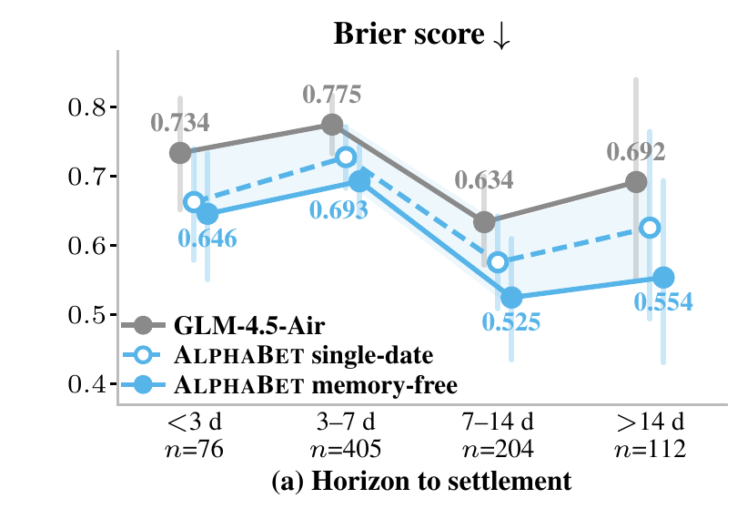
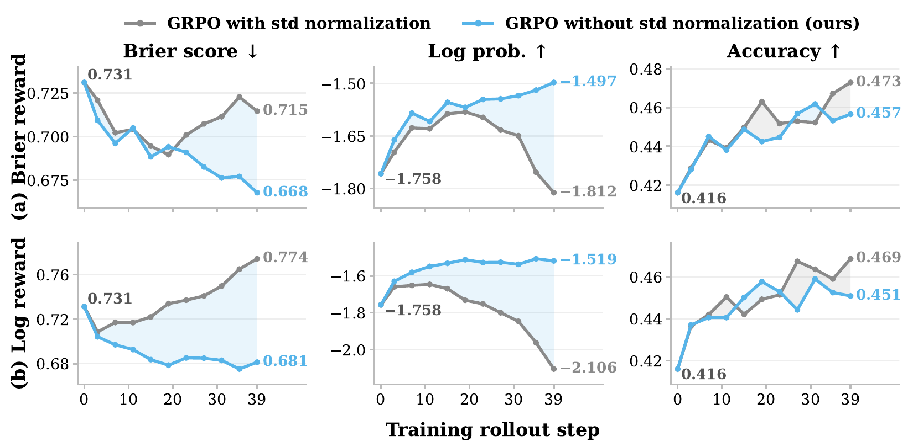
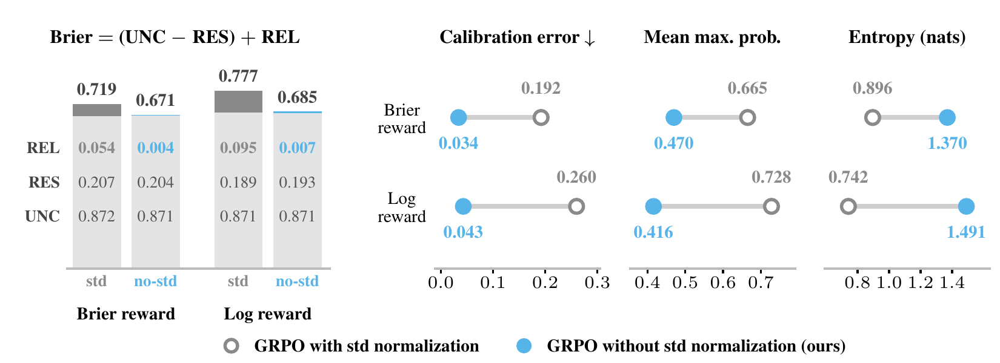

<p align="center">
  <picture>
    <source media="(prefers-color-scheme: dark)" srcset="assets/readme/logo-dark.png">
    
  </picture>
</p>

<h1 align="center">AlphaBet</h1>

<p align="center">
  <b>Reinforcement Learning for LLM Event Forecasting Agents</b><br>
  <i>Learn to forecast as the world evolves.</i>
</p>

<p align="center">
  <a href="https://arxiv.org/abs/2610.22684"></a>
  <a href="https://alphabet-agent.github.io/"></a>
  <a href="https://huggingface.co/collections/liqinye/alphabet"></a>
  <a href="pyproject.toml"></a>
  <a href="LICENSE"></a>
</p>

<p align="center"><sub>
Liqin Ye<sup>1†</sup> · Rongzhi Zhang<sup>2</sup> · Xin Liu<sup>2</sup> · Zheng Li<sup>2</sup> · Yuan He<sup>2</sup> · Qingyu Yin<sup>2</sup> · Priyanka Nigam<sup>2</sup> · Chao Zhang<sup>1</sup><br>
<sup>1</sup>Georgia Institute of Technology &nbsp;·&nbsp; <sup>2</sup>Amazon &nbsp;·&nbsp; <sup>†</sup>Work done during an internship at Amazon
</sub></p>

<p align="center">
  <a href="#results">Results</a>&nbsp;&nbsp;·&nbsp;&nbsp;
  <a href="#one-question-many-dates-one-outcome">How it works</a>&nbsp;&nbsp;·&nbsp;&nbsp;
  <a href="#models-and-data">Models</a>&nbsp;&nbsp;·&nbsp;&nbsp;
  <a href="#installation">Install</a>&nbsp;&nbsp;·&nbsp;&nbsp;
  <a href="#evaluate-a-released-checkpoint">Evaluate</a>&nbsp;&nbsp;·&nbsp;&nbsp;
  <a href="#train">Train</a>&nbsp;&nbsp;·&nbsp;&nbsp;
  <a href="#citation">Citation</a>
</p>

<p align="center"></p>
<p align="center"><sub><b>Figure 1.</b> Accuracy against Brier score on Forecast-Dojo (left) and FutureX (right); lower right is better. The dashed arrows run from GLM-4.5-Air to the same model after AlphaBet training (memory-free): +8.9 pp accuracy and −14.4% Brier on Forecast-Dojo, +6.6 pp and −13.7% on FutureX.</sub></p>

AlphaBet trains one LLM policy to search, reason, and report probabilities for an unresolved event at several dates before it resolves. Each dated forecast is scored by a proper scoring rule against the eventual outcome, so a single resolved event supervises decisions under several information states. On GLM-4.5-Air, AlphaBet lowers the Brier score from 0.731 to 0.626 on Forecast-Dojo and from 0.612 to 0.528 on FutureX.

- **Framework.** Outcome-based agentic RL over a temporally indexed offline news corpus: at each forecast date the policy can only read articles published on or before that date.
- **Theory.** One realized outcome properly supervises many dated forecasts. Forecasting regret decomposes into an information-acquisition gap and a probability-reporting gap, and GRPO's standard-deviation normalization can alter the intended multi-class probability target, whereas mean-centering preserves the expected reporting gradient of a strictly proper score.
- **Empirics.** Multi-date training improves forecasting on two benchmarks; controlled ablations attribute the gains to both better evidence acquisition and better probability reporting, and confirm the normalization analysis.

**Updates** · `[2026/10]` Paper on [arXiv](https://arxiv.org/abs/2610.22684); code in this repository; two checkpoints and the Forecast-Dojo dataset public in the [Hugging Face collection](https://huggingface.co/collections/liqinye/alphabet); [project website](https://alphabet-agent.github.io/) live.

## Results

Forecast-Dojo test set: 230 events and 797 question-dates resolving March–May 2026. FutureX: 343 L1–L2 questions. Every model runs the same agent loop and tool budget with 4 rollouts per task; open-weight models are sampled at temperature 0.6, top-p 1.0 and up to 32,768 output tokens, Claude Sonnet 4.6 at provider defaults. Bold marks the best value within the GLM-4.5-Air block; 95% confidence intervals are in the paper (Table 1).

<div align="center">
<table>
  <thead>
    <tr>
      <th rowspan="2" align="left">Model</th>
      <th colspan="3">Forecast-Dojo</th>
      <th colspan="2">FutureX</th>
    </tr>
    <tr>
      <th>Acc % ↑</th><th>Brier ↓</th><th>−Info-α ↓</th>
      <th>Acc % ↑</th><th>Brier ↓</th>
    </tr>
  </thead>
  <tbody>
    <tr><td align="left">Uniform reference</td><td align="center">22.9</td><td align="center">0.771</td><td align="center">0.727</td><td align="center">30.6</td><td align="center">0.680</td></tr>
    <tr><td colspan="6" align="left"><i>Off-the-shelf references (same agent loop and tool budget; not controlled baselines)</i></td></tr>
    <tr><td align="left">Claude Sonnet 4.6 (high)</td><td align="center">50.0</td><td align="center">0.624</td><td align="center">0.364</td><td align="center">58.9</td><td align="center">0.497</td></tr>
    <tr><td align="left">Kimi K2.5</td><td align="center">48.9</td><td align="center">0.663</td><td align="center">0.530</td><td align="center">57.5</td><td align="center">0.514</td></tr>
    <tr><td align="left">Qwen3.5-397B-A17B (think)</td><td align="center">48.2</td><td align="center">0.653</td><td align="center">0.482</td><td align="center">57.1</td><td align="center">0.556</td></tr>
    <tr><td align="left">Claude Sonnet 4.6 (low)</td><td align="center">47.6</td><td align="center">0.656</td><td align="center">0.468</td><td align="center">54.2</td><td align="center">0.564</td></tr>
    <tr><td align="left">MiniMax-M2.5</td><td align="center">45.9</td><td align="center">0.719</td><td align="center">0.738</td><td align="center">53.3</td><td align="center">0.555</td></tr>
    <tr><td colspan="6" align="left"><i>GLM-4.5-Air: controlled comparison on one base model</i></td></tr>
    <tr><td align="left">GLM-4.5-Air (base)</td><td align="center">41.6</td><td align="center">0.731</td><td align="center">0.726</td><td align="center">51.3</td><td align="center">0.612</td></tr>
    <tr><td align="left">&nbsp;&nbsp;+ BLF</td><td align="center">45.8</td><td align="center">0.671</td><td align="center">0.458</td><td align="center">51.1</td><td align="center">0.592</td></tr>
    <tr><td align="left">&nbsp;&nbsp;+ OpenForecaster</td><td align="center">42.8</td><td align="center">0.765</td><td align="center">0.845</td><td align="center">52.6</td><td align="center">0.583</td></tr>
    <tr><td align="left">&nbsp;&nbsp;+ AlphaBet single-date</td><td align="center">47.2</td><td align="center">0.668</td><td align="center">0.507</td><td align="center">53.2</td><td align="center">0.540</td></tr>
    <tr><td align="left">&nbsp;&nbsp;+ AlphaBet memory-on</td><td align="center">49.3</td><td align="center">0.630</td><td align="center">0.413</td><td align="center">55.2</td><td align="center">0.545</td></tr>
    <tr><td align="left"><b>&nbsp;&nbsp;+ AlphaBet memory-free</b></td><td align="center"><b>50.5</b></td><td align="center"><b>0.626</b></td><td align="center"><b>0.399</b></td><td align="center"><b>57.9</b></td><td align="center"><b>0.528</b></td></tr>
  </tbody>
</table>
</div>

<sub>Accuracy is top-1 on Forecast-Dojo and official answer matching on FutureX. Brier is the multiclass Brier score. Info-α is the log-probability gain of the forecast over the crowd forecast on the true outcome; the table shows −Info-α, so lower is better.</sub>

## One question, many dates, one outcome

AlphaBet revisits each training event at several dates before it resolves. At every date the policy sees only what the world knew then, commits to a probability distribution over the outcomes, and is scored against the one eventual outcome. A single resolved event therefore supervises decisions under several information states, with no extra labels: 1,028 training events become 3,965 question-date training states (3.86 dates per event on average, between 3 and 10).

<p align="center"></p>
<p align="center"><sub><b>Figure 2.</b> Top: one question revisited at dates 1…T as the corpus grows. Bottom: one forecast step — search, read and compute over the corpus up to date t, then report probabilities; a notebook can carry context forward. Right: each report is scored against the resolved outcome; mean-centered GRPO updates the policy.</sub></p>

- **Evidence lives in a replayable corpus.** Retrieval runs over a temporally indexed offline CC-News corpus (March 2025 to May 2026, 18.8M article embeddings from Qwen3-Embedding-8B, FAISS) and returns only articles dated on or before the forecast date.
- **Three tools, one budget.** `search` (5 results by default, adjustable by the agent), `scrape` to read an article (up to 8,000 tokens) and `python` for sandboxed computation (10 s and 4 GiB per call), within 80 tool rounds and 200 calls per forecast date.
- **A proper score is the reward.** Each dated forecast earns the negative multiclass Brier score against the eventual outcome, plus format penalties (answer format coefficient 1.0, tool format 0.5). The log score is available as an alternative reward.
- **GRPO with the mean, not the std.** Rollouts are grouped per (question, forecast date) and the advantage is the group-mean-centered reward, A = R − R<sub>mean</sub>, with no division by the group's standard deviation.

| Variant | Mode | Carried across dates |
|:--|:--|:--|
| Memory-free | `memory-free` | Nothing; every dated forecast starts afresh. The paper's strongest variant. |
| Memory-on | `memory-on` | A belief notebook (probabilities, evidence, open questions); everything else starts fresh. |
| Single-date | `single_date` | One fixed forecast date per event with the memory-free interface; the ablation. |

<sub><code>scripts/train.sh</code> takes the training mode as <code>single_date</code>; <code>scripts/prepare_data.sh</code> spells the data mode <code>single-date</code>.</sub>

## The gains come from both acquisition and reporting

Freeze the evidence each policy retrieved on the Forecast-Dojo test set, then let tool-free readers forecast from it. Every reader scores better on AlphaBet's evidence than on the base model's (acquisition gain of 0.011 to 0.016 Brier). Given identical evidence, AlphaBet reports better than its base model by 0.058 to 0.060 (reporting gain).

<div align="center">

| Reader (no tools) | GLM-4.5-Air evidence | AlphaBet evidence | Question only | Δ acquisition ↑ |
|:--|--:|--:|--:|--:|
| GPT-5.6 Terra (xhigh) | 0.623 | 0.612 | 0.725 | +0.011\* |
| Claude Sonnet 4.6 (high) | 0.649 | 0.638 | 0.763 | +0.012\* |
| GLM-4.5-Air | 0.702 | 0.686 | 0.801 | +0.016\*\* |
| AlphaBet memory-free | 0.642 | 0.628 | 0.765 | +0.014\* |
| **Δ reporting ↑** | +0.060\*\*\* | +0.058\*\*\* | +0.035\*\* | |

</div>

<sub>Brier ↓ on the Forecast-Dojo test set (paper Table 2). Δ reporting: GLM-4.5-Air → AlphaBet memory-free on identical evidence. \* p < .05, \*\* p < .01, \*\*\* p < .001.</sub>

Multi-date supervision matters most far from settlement.

<p align="center"></p>
<p align="center"><sub><b>Figure 3.</b> Brier ↓ on the Forecast-Dojo test set by horizon to settlement. The gain of memory-free over single-date training shrinks as settlement nears: 0.072 (more than 14 days), 0.051 (7–14 days), 0.035 (3–7 days), 0.017 (under 3 days).</sub></p>

<details>
<summary>Brier by horizon</summary>
<br>

| Horizon to settlement | n | GLM-4.5-Air | AlphaBet single-date | AlphaBet memory-free |
|:--|--:|--:|--:|--:|
| more than 14 d | 112 | 0.692 | 0.626 | **0.554** |
| 7–14 d | 204 | 0.634 | 0.576 | **0.525** |
| 3–7 d | 405 | 0.775 | 0.728 | **0.693** |
| under 3 d | 76 | 0.734 | 0.663 | **0.646** |

</details>

## Mean-centering is enough; std normalization distorts the proper-score target

GRPO usually divides each group's centered rewards by their standard deviation. Under a strictly proper score, the mean-centered reward already carries the intended expected reporting gradient; dividing by the std rescales every group differently and can change the multi-class probability the policy is pushed toward (paper, Prop. 2). AlphaBet therefore uses A = R − R<sub>mean</sub> within each (question, date) group and keeps std normalization only as an ablation.

<p align="center"></p>
<p align="center"><sub><b>Figure 4.</b> Forecast-Dojo training curves with (grey) and without (blue) std normalization, under a Brier reward (top) and a log reward (bottom). Without std, both proper scores keep improving; with std they progressively degrade while top-1 accuracy stays comparable.</sub></p>

<div align="center">

| Reward | Advantage | Brier ↓ | Log prob ↑ | Accuracy ↑ | Reliability ↓ |
|:--|:--|--:|--:|--:|--:|
| — | step 0 | 0.731 | −1.758 | 0.416 | |
| Brier | mean, then std | 0.715 | −1.812 | 0.473 | 0.054 |
| Brier | **mean only** | **0.668** | **−1.497** | 0.457 | **0.004** |
| Log | mean, then std | 0.774 | −2.106 | 0.469 | 0.095 |
| Log | **mean only** | **0.681** | **−1.519** | 0.451 | **0.007** |

</div>

<sub>Forecast-Dojo at training step 39, common-valid forecasts. Reliability is the REL term of the binned Murphy decomposition of the Brier score; resolution is essentially unchanged. Under the Brier reward, std normalization also produced 121 invalid forecasts out of 3,188 against 3 without it, and sharpened the policy over-confidently: mean max probability 0.665 vs 0.470, entropy 0.896 vs 1.370 nats.</sub>

<details>
<summary>Calibration diagnostics</summary>
<br>
<p align="center"></p>
<p align="center"><sub>Binned Murphy decomposition Brier = (UNC − RES) + REL (one-vs-rest entries, ten equal-width probability bins; the totals approximate the multiclass Brier in the table), calibration error, mean max probability and entropy, with and without std normalization, under both rewards.</sub></p>
</details>

## Models and data

| Artifact | What it is | Download |
|:--|:--|:--|
| **AlphaBet memory-free** | GLM-4.5-Air trained with AlphaBet in memory-free mode; the paper's strongest variant | [liqinye/AlphaBet_memory-free](https://huggingface.co/liqinye/AlphaBet_memory-free) |
| **AlphaBet memory-on** | GLM-4.5-Air trained in memory-on mode, carrying a belief notebook across dates | [liqinye/AlphaBet_memory-on](https://huggingface.co/liqinye/AlphaBet_memory-on) |
| **Forecast-Dojo** | Resolved Polymarket events with fixed forecast dates, outcome labels and market probabilities (CC-BY-4.0) | [liqinye/Forecast-Dojo](https://huggingface.co/datasets/liqinye/Forecast-Dojo) |

Both checkpoints are built on GLM-4.5-Air (106B total, 12B active parameters) and ship as `glm4_moe` safetensors (40 shards, about 214 GB each), public and ungated, in the [AlphaBet collection](https://huggingface.co/collections/liqinye/alphabet). The dataset's rows are complete memory-on episodes (`metadata.forecast_dates`, `metadata.crowd_probs`) that the evaluation harness reads directly; its `eval` split (230 events / 797 question-dates) is the paper's Forecast-Dojo test set, while its `train` split (1,338 events / 5,325 tasks) is a larger release than the 1,028-event training set used in the paper: it reaches back to June 2025, and 285 of its events have a first forecast date on or before the GLM-4.5-Air checkpoint date (2025-07-28), so filter on `metadata.forecast_dates` to match the paper's window.

> [!NOTE]
> The news corpus and its FAISS indexes are not hosted. Build them with the [Forecast-Dojo](https://github.com/Forecast-Dojo/Forecast-Dojo) pipeline; [Prepare data](#prepare-data) describes the layout the retriever expects.

## Installation

Python 3.10 or newer. Install the shared runtime first: the root package pins `strands-env==0.1.0+alphabet`, which resolves only from the local `strands-env/` directory.

```bash
git clone https://github.com/AlphaBet-Agent/AlphaBet.git
cd AlphaBet
pip install -e strands-env && pip install -e .
```

This installs the `alphabet-eval`, `alphabet-build-data` and `alphabet-build-single-date` commands. Model serving is separate and not installed by the package: the policy is served with SGLang (`scripts/serve_model.sh`) and the embeddings with vLLM (`scripts/serve_embeddings.sh`, in its own vLLM environment).

## Evaluate a released checkpoint

```text
download checkpoint + events → serve embeddings → serve policy → evaluate → read the scorecard
```

Besides this repository you need a date-sharded FAISS index of the news corpus ([layout](#prepare-data); built with the Forecast-Dojo pipeline, not included here), the Qwen3-Embedding-8B weights, GPUs for the 106B-A12B policy (`serve_model.sh` defaults to tensor parallelism 4), and a Linux host that allows unprivileged user namespaces: the `python` tool checks its process-isolation sandbox at start-up and fails closed without it (`FORECAST_PYTHON_SANDBOX=off` disables the isolation for debugging; such runs are not valid benchmark numbers). Datasets, weights and indexes live outside the repository; the examples use `/datasets`, `/models` and `/indexes`.

**1. Download a checkpoint and the evaluation events** (`hf` is the Hugging Face CLI from `huggingface_hub` ≥ 0.34; the legacy `huggingface-cli download`, removed in 1.0, takes the same arguments).

```bash
hf download liqinye/AlphaBet_memory-free --local-dir /models/AlphaBet_memory-free   # ~214 GB
hf download liqinye/Forecast-Dojo data/eval.jsonl --repo-type dataset \
  --local-dir /datasets/forecast-dojo   # lands at /datasets/forecast-dojo/data/eval.jsonl
```

**2. Serve the embedding model.** It listens on port 8001 (`PORT`) under the name `Qwen3-Embedding-8B`, matching `embedding_endpoint` and `embedding_model` in the evaluation configs.

```bash
HOST=0.0.0.0 EMBEDDING_MODEL_PATH=/models/Qwen3-Embedding-8B \
  bash scripts/serve_embeddings.sh --tensor-parallel-size 1 --max-model-len 4096
```

**3. Serve the policy** in a separate terminal. The server listens on port 30000 (`PORT`) with tensor parallelism 4 (`TENSOR_PARALLEL_SIZE`), matching `base_url` in the configs; extra arguments pass through to `sglang.launch_server`.

```bash
HOST=0.0.0.0 MODEL_PATH=/models/AlphaBet_memory-free bash scripts/serve_model.sh
```

**4. Run the benchmark.** Set the paths and service addresses in the YAML (`model.base_url`, `env.index_root`, `env.embedding_endpoint`, `data.questions_path`, `output_path`). `model.tokenizer_path` (`zai-org/GLM-4.5-Air` in the shipped configs) is resolved through the Hugging Face Hub; on a host without Hub access, point it at the downloaded checkpoint directory. Then run from another terminal:

```bash
# AlphaBet_memory-free: one row per question-date (eval_memory-free.jsonl, built below)
bash scripts/evaluate.sh --config configs/eval/memory-free.yaml
# AlphaBet_memory-on: the release rows run as they are (data/eval.jsonl)
bash scripts/evaluate.sh --config configs/eval/memory-on.yaml
```

`python -m evaluation --config …` and `alphabet-eval --config …` are equivalent. Evaluate each checkpoint in its own mode, as the paper does: `AlphaBet_memory-free` with `memory-free.yaml`, `AlphaBet_memory-on` with `memory-on.yaml`. The row format must match `env.mode` (the harness fails fast on a mismatch): the release ships memory-on episodes, which `memory-on.yaml` reads directly, while `memory-free.yaml` needs one row per question-date. Those rows are the per-date split that `scripts/prepare_data.sh memory-free` performs on the raw question files; the release can be split the same way, giving exactly the paper's 797 question-dates:

```python
import json

DROP = ("forecast_dates", "crowd_probs", "crowd_distributions")
rows = [json.loads(l) for l in open("/datasets/forecast-dojo/data/eval.jsonl") if l.strip()]
with open("/datasets/forecast-dojo/data/eval_memory-free.jsonl", "w") as f:
    for r in rows:
        m = r["metadata"]
        keep = {k: v for k, v in m.items() if k not in DROP}
        for d, cp in zip(m["forecast_dates"], m["crowd_probs"]):
            row = {**r, "metadata": {**keep, "forecast_date": d, "crowd_prob": cp}}
            f.write(json.dumps(row) + "\n")
```

The shipped configs follow the paper's protocol: 4 rollouts per task, temperature 0.6, top-p 1.0, 32,768 output tokens, Search/Read/Compute with at most 80 rounds and 200 calls per date, Brier as the selected reward metric (both proper scores are always logged), concurrency 8, full traces kept. Search uses local CPU FAISS; the optional GPU search server is deployed separately and is not included.

**5. Read the results.** A scorecard (Brier, log loss, accuracy, Info-α) prints when the run finishes. Records go to `output_path`, one JSON line per forecast step (`forecast_date`, `agent_forecast`, `resolved_label`, `brier`, `log_prob`, `accuracy`, `info_alpha` and, with `keep_trace`, the full `agent_trace`), with a `.manifest.json` sidecar holding the resolved configuration and the exact system prompt. Re-running with the same `output_path` resumes: completed `(event_id, rollout_idx)` pairs are skipped (for memory-free rows this key is per event, so an event with any date on disk is not re-run), and episodes that raised are stored as error rows. Error rows and unparsable forecasts (`parse_ok` false) are excluded from the means; the scorecard also reports `n_rows`, `n_scored` and `n_errors`. To re-score an existing file:

```python
from evaluation.metrics import format_scorecard, score_run

print(format_scorecard(score_run("outputs/memory-on.jsonl")))
```

<details>
<summary>Command-line flags</summary>
<br>

With `--config`, only `--output-path`, `--concurrency` and `--n-rollouts` override the file; the other flags are for runs without a config, where `--model`, `--index-root`, `--questions-path` and `--output-path` are required.

- `--config PATH` — YAML or JSON `RunConfig` (`model` / `env` / `data` blocks plus top-level keys)
- `--model NAME` — Preset from `evaluation.run.MODEL_PRESETS` (`glm-4.5-air`, `qwen3-30b`, `claude-opus`) or an ad-hoc label
- `--model-id ID` — Override the preset's model id or path
- `--backend {sglang,bedrock,kimi}` — Model backend (default `sglang`)
- `--index-root PATH` — FAISS index root
- `--questions-path PATH` — Questions JSONL; its row format must match `--mode`
- `--split LABEL` — Label stamped into every record
- `--mode {memory-on,memory-free}` — Episode mode (default `memory-on`)
- `--no-search` — Selects the tool-free environment (`src/environment/env_no_search.py`), which is not yet wired into the harness: `run()` raises `NotImplementedError`
- `--output-path PATH` — Output JSONL
- `--concurrency N`, `--n-rollouts N` — Parallel episodes (default 8) and independent rollouts per question (default 1)

</details>

## Prepare data

`scripts/prepare_data.sh` turns the raw Forecast-Dojo question files (the `filtered_info.jsonl` question file from the [Forecast-Dojo](https://github.com/Forecast-Dojo/Forecast-Dojo) pipeline, with daily market histories; `--news-volume` adds article counts from the index) into the mode-specific JSONL that the trainer and the evaluator read; pass `--help` after a mode for the full option list. The Hugging Face release already contains built memory-on rows.

```bash
bash scripts/prepare_data.sh memory-free --input QUESTIONS --output DATASET --auto-k
bash scripts/prepare_data.sh memory-on   --input QUESTIONS --output DATASET --auto-k
bash scripts/prepare_data.sh single-date --input MEMORY_FREE_DATASET \
  --out DATASET --seed 20260918
```

| Mode | One row per | Date fields in `metadata` | Consumed by |
|:--|:--|:--|:--|
| `memory-free` | question × forecast date | `forecast_date`, `crowd_prob` | `configs/train/memory-free.sh`, `configs/eval/memory-free.yaml` |
| `memory-on` | event, with its chronological forecast dates | `forecast_dates`, `crowd_probs` | `configs/train/memory-on.sh`, `configs/eval/memory-on.yaml` |
| `single-date` | event, one seeded date from its early, middle or late third | as memory-free | `configs/train/single_date.sh` (train mode `single_date`) |

`--auto-k` picks K(H) = clamp(round(c·√H), 3, 10) forecast dates across each question's horizon H (`--k-min`, `--k-max`, `--c`), each at least `--min-days-before-resolution` 2 days before resolution; `--index-root` sets the retrieval-window start from the earliest shard, and `--news-volume` lets the date picker weigh daily article counts. `single-date` writes `selection.jsonl` and `build_stats.json` beside its output; seed 20260918, the default, reproduces the paper's subset from the paper's memory-free training file (the seeded shuffle depends on the input's event set).

**Splits used in the paper.**

| Split | Events | Question-dates | Window |
|:--|--:|--:|:--|
| Train | 1,028 | 3,965 | forecast dates 2025-08-01 to 2026-02-28; 383 binary and 645 multi-option events |
| Validation | 80 | 344 | events closing 2026-01-01 to 2026-02-28 |
| Test | 230 | 797 | events resolving March–May 2026 |
| FutureX | 343 | — | L1–L2 questions: 138 yes/no, 193 multiple-choice, 12 free-form |

The policy is GLM-4.5-Air (106B total, 12B active), public checkpoint dated 2025-07-28; every training event post-dates it.

**News corpus.** Retrieval runs over a temporally indexed CC-News corpus (March 2025 to May 2026, 18.8M article embeddings from Qwen3-Embedding-8B, FAISS) built with the same collection, preprocessing and indexing pipeline as Forecast-Dojo ([paper](https://arxiv.org/abs/2609.28876), [repository](https://github.com/Forecast-Dojo/Forecast-Dojo)). Each forecast retrieves only articles published on or before its forecast date. The retriever expects dated shard directories named `YYYY-MM` or `YYYY-MM-DD` under the index root:

```text
/indexes/faiss_index_monthly/
├── 2025-03/
│   ├── faiss.index
│   ├── texts.parquet
│   └── metadata.json      # monthly shards also carry day_offsets
├── 2025-04/
└── ...
```

## Train

> [!IMPORTANT]
> The paper's runs use 128 H200 GPUs for the policy (16 nodes × 8) plus 8 GPUs for retrieval. A 120-step memory-free run takes about 62 hours; memory-on is about 2.3× slower per step. `configs/train/common.sh` encodes this topology (TP 4 · PP 1 · CP 2 · EP 8 · ETP 4; 8 GPUs per rollout engine); every value can be overridden from the environment.

Training runs on [slime](https://github.com/THUDM/slime) with [Megatron-LM](https://github.com/NVIDIA/Megatron-LM) for optimization, SGLang for rollouts and Ray for orchestration. None of these is vendored: `scripts/train.sh` submits a job to a running Ray cluster that already has AlphaBet and this stack installed (`RAY_DASHBOARD_ADDRESS`, default `http://127.0.0.1:8265`). Start the embedding service first ([step 2](#evaluate-a-released-checkpoint)); slime manages its own policy servers.

```bash
SLIME_ROOT=/root/slime \
MEGATRON_ROOT=/root/Megatron-LM \
TRAIN_PYTHON=python \
MODEL_PATH=/models/GLM-4.5-Air \
REF_LOAD=/models/megatron_checkpoint \
TRAIN_DATA=/datasets/memory-free/forecast_train.jsonl \
EVAL_DATA=/datasets/memory-free/forecast_validation.jsonl \
INDEX_ROOT=/indexes/faiss_index_monthly \
EMBEDDING_ENDPOINT=http://embedding-host:8001/v1 \
bash scripts/train.sh memory-free

# Other modes, with the matching prepared inputs:
#   bash scripts/train.sh memory-on
#   bash scripts/train.sh single_date       # TRAIN_DATA = the seed-20260918 single-date subset
# Print the resolved configuration and command without loading anything:
#   bash scripts/train.sh memory-free --dry-run
# Pass extra slime arguments after "--".
```

| Variable | Required | Meaning |
|:--|:-:|:--|
| `SLIME_ROOT` | yes | slime checkout containing `train.py` |
| `MODEL_PATH` | yes | Hugging Face checkpoint of the policy (GLM-4.5-Air) |
| `REF_LOAD` | yes | Megatron-format checkpoint of the base model, passed as `--ref-load` |
| `TRAIN_DATA` | yes | Prepared training JSONL for the chosen mode |
| `INDEX_ROOT` | yes | FAISS index root (exported to the workers as `FORECAST_INDEX_ROOT`) |
| `EMBEDDING_ENDPOINT` | yes | Embedding service URL (exported as `FORECAST_EMBEDDING_ENDPOINT`) |
| `EVAL_DATA` | | Validation JSONL; enables evaluation every 4 steps (4 samples per prompt, temperature 0.6, top-p 1.0, 32,768 tokens) |
| `MEGATRON_ROOT`, `TRAIN_PYTHON`, `MODEL_ARGS_SH` | | Megatron-LM checkout added to `PYTHONPATH`; interpreter for the job (default `python3`); model arguments (default `$SLIME_ROOT/scripts/models/glm4.5-106B-A12B.sh`) |
| `RAY_DASHBOARD_ADDRESS`, `RUN_DIR` | | Ray job address; run directory (default `outputs/<mode>`), with checkpoints in `$RUN_DIR/checkpoints` every 4 steps |
| `WANDB_PROJECT`, `WANDB_GROUP` | | Weights & Biases logging |

**Ablations.** `FORECAST_GRPO_STD_NORM=1` restores GRPO's std normalization (`configs/train/common.sh` exports `0`). `FORECAST_REWARD_METRIC=log_prob` trains with the log score instead of the Brier score. `single_date` trains on one fixed date per event: point `TRAIN_DATA` at the single-date subset and keep `EVAL_DATA` on the memory-free validation set.

<details>
<summary>Hyperparameters and launcher settings (<code>configs/train/common.sh</code>, paper Table 3)</summary>
<br>

| Setting | Value |
|:--|:--|
| Rollouts per group | 16 at temperature 1.0 |
| Prompt / response length | 8,192 / 16,384 tokens |
| Groups per rollout step | 128 (memory-free, single_date) · 64 (memory-on) |
| Optimizer batch | 1,024 (memory-free, single_date) · 512 (memory-on) rollouts |
| Optimizer | Adam, lr 1e-6 constant, no warmup, β = (0.9, 0.95), weight decay 0.1 |
| Clipping / regularizers | ε = 0.20 / ε<sub>high</sub> = 0.28; entropy coefficient 0; no KL term |
| Precision | bf16 |
| Parallelism | TP 4 · PP 1 · CP 2 · EP 8 · ETP 4; 8 GPUs per SGLang engine, DP-attention 8 |
| Reward | −Brier plus format penalties (answer 1.0, tool 0.5) |
| Compute tool | 10 s timeout, 4,096 MB memory per call |
| Checkpoints and evaluation | every 4 steps |
| Rollout steps | `NUM_ROLLOUT`, default 1000; the paper's 62-hour figure is a 120-step run |

`train.sh` sources `configs/train/common.sh` and `configs/train/<mode>.sh`, then submits `$SLIME_ROOT/train.py` with `--advantage-estimator grpo` and three AlphaBet callbacks (plus `eval_generate_rollout` and `log_eval_rollout_metrics` from the same module when `EVAL_DATA` is set): `training.generate_with_forecast.generate_and_rm` (rollout and reward; one training sample per forecast step), `training.generate_with_forecast.log_rollout_metrics`, and `training.grpo_group_normalizer.normalize_by_group_index` (groups rewards by (question, forecast date) and centers them by the group mean). `FORECAST_*` and `WANDB_*` variables are forwarded to the Ray workers.

| Variable | Default | Effect |
|:--|:--|:--|
| `FORECAST_REWARD_METRIC` | `brier` | Score optimized by GRPO: `brier` (−Brier) or `log_prob` (log score); both are always logged |
| `FORECAST_GRPO_STD_NORM` | `0` | `1` divides centered rewards by the group std (ablation) |
| `FORECAST_ENABLE_CODE` | `1` | `0` removes the Python tool (search-only ablation) |
| `FORECAST_FORMAT_COEF`, `FORECAST_TOOL_FORMAT_COEF` | `1.0`, `0.5` | Answer-format and tool-call-format penalty weights |
| `FORECAST_CODE_TIMEOUT`, `FORECAST_CODE_MEMORY_MB` | `10`, `4096` | Python sandbox limits per call |
| `FORECAST_SEARCH_BACKEND` | `cpu` | `gpu` routes search to an external server at `FORECAST_SEARCH_ENDPOINT` (not included) |
| `FORECAST_MAX_STEPS` | `100` | Stride of the per-(question, date) GRPO group index for memory-on episodes; must be at least the longest episode's number of forecast dates |

</details>

## Repository layout

```text
configs/
  eval/                 memory-free.yaml, memory-on.yaml: evaluation run configurations
  train/                common.sh (defaults), memory-free.sh, memory-on.sh, single_date.sh
scripts/
  prepare_data.sh       build memory-free, memory-on or single-date task files
  train.sh              submit a slime GRPO run to a Ray cluster (--dry-run prints the command)
  evaluate.sh           run the benchmark harness (python -m evaluation)
  serve_model.sh        SGLang policy server for evaluation
  serve_embeddings.sh   vLLM server for Qwen3-Embedding-8B
prompts/                system prompts: {memory-free, memory-on} x {tools, no code, no tools}
src/
  data/                 forecast-date selection, dataset builders, domain/placeholder filters
  environment/          ForecastEnv loop, search/scrape/python tools, notebook parsing, rewards
  training/             slime rollout callbacks and per-(question, date) GRPO grouping
  evaluation/           benchmark harness (run.py) and metrics (score_run, format_scorecard)
strands-env/            shared environment runtime (Apache-2.0)
assets/readme/          figures and logo used in this README
```

Also worth knowing: `ModelSpec.backend` accepts `sglang`, `bedrock` and `kimi`, and `model.prompt_variant` or `model.system_prompt_path` swap the system prompt; the six prompts in `prompts/` are selected by `prompts.get_prompt_path(mode, enable_code=…, search=…)` and shared by training and evaluation; the GPU search server, prepared training JSONL and the corpus indexes are not part of this repository.

## Acknowledgements

AlphaBet builds on [Forecast-Dojo](https://github.com/Forecast-Dojo/Forecast-Dojo) ([paper](https://arxiv.org/abs/2609.28876)) for the forecasting environment, benchmark and corpus pipeline. Training uses [slime](https://github.com/THUDM/slime), [Megatron-LM](https://github.com/NVIDIA/Megatron-LM), SGLang and Ray; the agent runtime uses strands-agents and [strands-sglang](https://github.com/strands-rl/strands-sglang); retrieval uses Qwen3-Embedding-8B and FAISS; the policy is GLM-4.5-Air. The code sandbox in `src/environment/subprocess_interpreter.py` is adapted from CAMEL-AI via slime and keeps its attribution.

## Citation

```bibtex
@misc{ye2026alphabetreinforcementlearningllm,
      title={AlphaBet: Reinforcement Learning for LLM Event Forecasting Agents},
      author={Liqin Ye and Rongzhi Zhang and Xin Liu and Zheng Li and Yuan He and
              Qingyu Yin and Priyanka Nigam and Chao Zhang},
      year={2026},
      eprint={2610.22684},
      archivePrefix={arXiv},
      primaryClass={cs.LG},
      url={https://arxiv.org/abs/2610.22684},
}
```

If you use the environment or corpus pipeline, please also cite [Forecast-Dojo](https://arxiv.org/abs/2609.28876). Questions: open an issue, or write to `{liqiny,chaozhang}@gatech.edu`.

## License

This repository is released under the [MIT License](LICENSE) (Copyright 2026 Liqin Ye). The `strands-env/` runtime is licensed under [Apache-2.0](strands-env/LICENSE) (Strands RL Contributors), and source files retain their third-party copyright and license notices.
